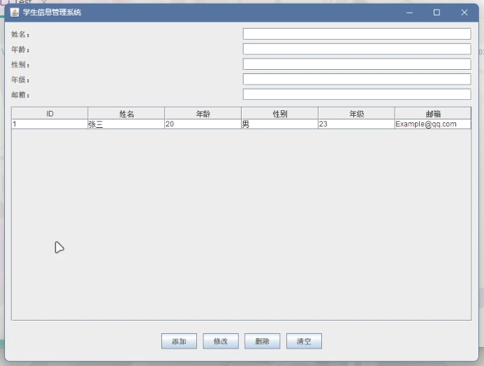
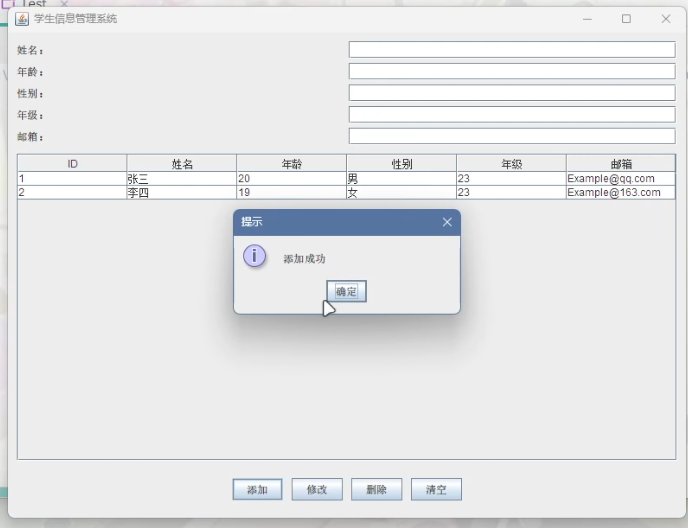
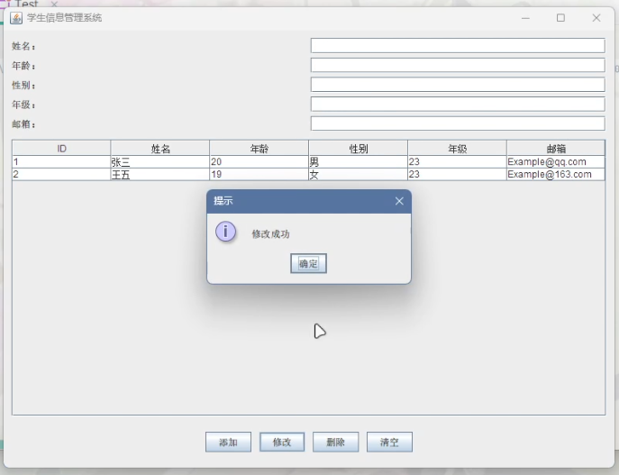
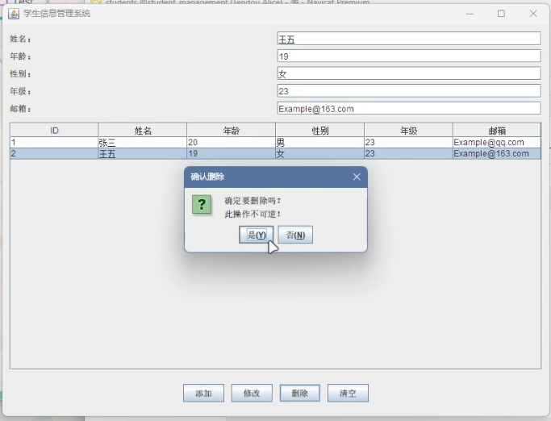
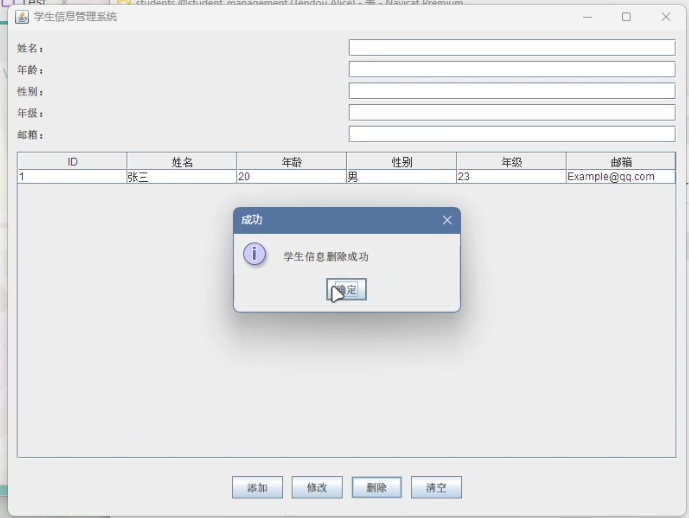

# StudentManagementSystem

这是一个基于 Java 和 MySQL 的学生信息管理系统，实现了学生信息的增删改查功能。该项目适合用于课程设计或作为 Java 桌面应用开发的参考示例。

---

## 📌 项目简介

本系统提供了一个图形化界面，可以连接 MySQL 数据库，并对学生信息进行管理操作：

- 添加学生
- 修改学生信息
- 删除学生
- 查询所有学生信息
- 清空输入框等辅助功能

---

## 🧱 技术栈

- **编程语言**：Java (JDK 8+)
- **数据库**：MySQL 8.0+
- **数据库连接驱动**：JDBC

---

## 📁 文件结构

```
StudentManagementSystem/
├── src/
│   ├── StudentManagementSystem/
│   │   ├── dao/              # 数据访问层，封装与数据库交互逻辑
│   │   ├── model/            # 实体类和数据库连接类
│   │   ├── view/             # 图形用户界面（GUI）
│   │   └── Test.java         # 程序入口类
├── sql/
│   └── student_management.sql # 数据库初始化脚本
├── README.md
└── LICENSE
```


---

## 🛠️ 配置说明

### 数据库配置

在 `model/DatabaseConnection.java` 中配置数据库连接参数：

```java
private static final String URL = "jdbc:mysql://localhost:3306/student_management?useSSL=false&serverTimezone=Asia/Shanghai";
private static final String USER = "root";
private static final String PASSWORD = "YOUR_MYSQL_PASSWORD"; // 请根据实际情况修改密码
```


### 数据库初始化

运行 `sql/student_management.sql` 脚本以创建表并插入初始数据。

如果你不习惯sql命令行操作，可参考下文**运行方式**中的方法。

---

## ▶️ 运行方式

1. 导入项目到 IDE（如 IntelliJ IDEA 或 Eclipse）。
2. 添加 MySQL JDBC 驱动依赖（推荐使用 Maven 或手动添加 JAR）。
3. （可选）手动配置MySQL和Navicat，导入项目的sql文件创建数据库和表。
4. 编译并运行 [Test.java](file://C:\Users\PixelGeek521\IdeaProjects\StudentManagementSystem\src\StudentManagementSystem\Test.java)。
5. 系统会自动连接数据库并打开主界面。

---

## 💻 功能截图






---

## 📜 许可证

本项目采用 **[MIT License](LICENSE)**

可以随意复制转发，但请保留版权声明。 详情见 LICENSE 文件。

---

## 🤝 关于以后

这只是一个很简陋的Java项目，最大的用途也就帮大学生们糊弄Java课设。

因此该项目几乎不会更新，亦不接受PR、issue等，仅供初学者学习参考。
